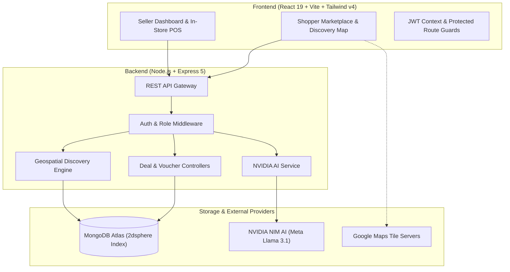
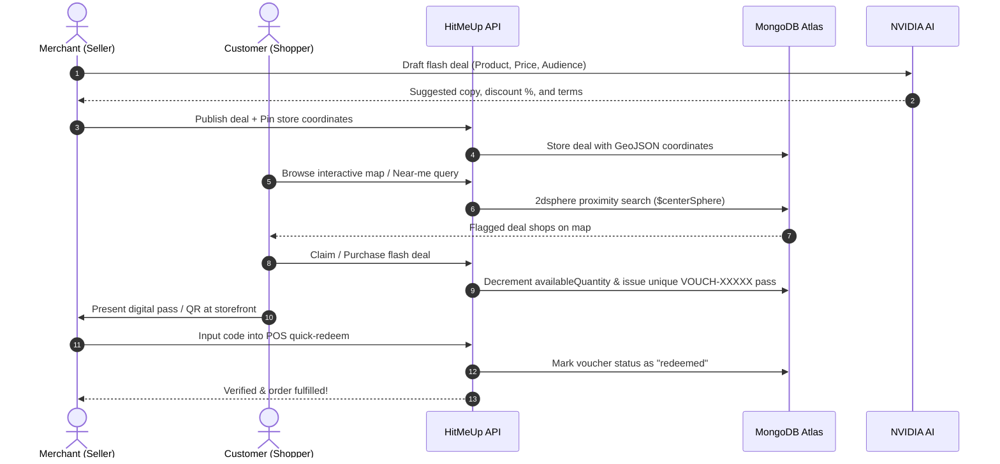

<div align="center">

# ⚡ HitMeUp

### *Discover More. Spend Less. Deal Smarter.*

**A modern, AI-powered real-time flash deals marketplace connecting local merchants with shoppers.**

[](https://react.dev/)
[](https://vitejs.dev/)
[](https://tailwindcss.com/)
[](https://nodejs.org/)
[](https://expressjs.com/)
[](https://www.mongodb.com/)
[](https://leafletjs.com/)
[](https://build.nvidia.com/)
[](LICENSE)

[**Explore Features**](#-core-features) • [**Interactive Map**](#-interactive-map--geospatial-engine) • [**Tech Stack**](#-technology-stack) • [**Architecture**](#-architecture--data-flow) • [**Getting Started**](#-getting-started) • [**API Reference**](#-api-endpoints)

---

</div>

## 🌟 Overview

**HitMeUp** is a full-stack MERN marketplace designed to solve the friction of discovering and redeeming limited-time **flash promotions** from local retail stores, cafes, salons, and restaurants.

Shoppers can explore deals on an **interactive multi-store map**, filter by categories and proximity, purchase or claim instant vouchers, and redeem them in-store via secure QR/passcodes. Businesses manage promotions with an **NVIDIA AI Copilot**, set precise store coordinates, and redeem customer passes directly through a built-in POS dashboard.

---

## ✨ Core Features

### 🛍️ Shopper Experience
* **🗺️ Interactive Deals Map**: Flag every merchant offering live deals simultaneously. Center on user GPS, switch between street & satellite layers, and get instant turn-by-turn Google Maps directions.
* **⚡ Live Flash Promotions**: Browse curated discounts across Restaurants, Fashion, Electronics, Health & Beauty, and Services with real-time countdown clocks and quantity caps.
* **📍 Proximity-Aware Filtering**: MongoDB `2dsphere` geospatial indexing finds offers closest to the customer's coordinates.
* **🎟️ Digital Voucher Passes**: One-click claim or purchase of vouchers with live database inventory deduction and unique alphanumeric codes (`VOUCH-XXXXX`).
* **📱 Customer Dashboard**: Manage claimed vouchers, inspect expiration countdowns, view store details, and toggle QR passes for seamless merchant check-in.

### 🏪 Merchant & Seller Center
* **🤖 NVIDIA AI Deal Copilot**: Auto-draft viral titles, persuasive descriptions, recommended discount percentages, and target customer profiles using the NVIDIA AI NIM integration.
* **📌 Drag-and-Drop Storefront Pinning**: Interactively click or drag on the map inside the Seller Dashboard to pinpoint exact storefront coordinates.
* **⚡ In-Store POS Quick-Redeem**: Verify and redeem customer voucher codes with immediate database validation to prevent reuse.
* **📊 Real-Time Metrics Overview**: Monitor total deals, live promotions, draft statuses, inventory pools, and average store discounts.
* **🇱🇰 Sri Lanka Locations Dataset**: Integrated district and city database for fast registration and localized promotion targeting.

### 🛡️ Administration & Quality
* **👥 Account & Role Governance**: Role-based access control (`customer`, `seller`, `business`, `admin`) with protected API routes.
* **🔍 Deal Moderation**: Automatic content checks and manual status toggles (`active`, `draft`, `expired`).
* **🛡️ Fraud Prevention**: AI-assisted evaluation flags suspicious order spikes, abnormal redemption rates, or high-risk activity.

---

## 🗺️ Interactive Map & Geospatial Engine

HitMeUp combines **Leaflet.js** with high-resolution **Google Maps tile layers** to provide an enterprise-grade map experience **without requiring a paid Google Cloud billing account or credit card**:

```
                       Interactive Multi-Store Map Stage
 ┌────────────────────────────────────────────────────────────────────────┐
 │  [ 📍 One Galle Face • 3 Deals ]          [ 📍 Ministry of Crab • 1 ]  │
 │                                                                        │
 │                               [ 🔵 You are here ]                      │
 │                                                                        │
 │               [ 📍 Colombo Fort Cafe • 2 Deals ]                       │
 └────────────────────────────────────────────────────────────────────────┘
    ▲ Zoom / Layer Switcher (Streets ⇄ Satellite)  ▲ "Fit All" Compass
```

* **Multi-Store Simultaneous Flagging**: All merchants with active flash deals are rendered concurrently with branded SVG pins displaying store names, deal counts, and discount tags.
* **Two-Way Sync**: Clicking any map pin smoothly pans the map and highlights that store's deals in the right-hand panel.
* **Turn-by-Turn Navigation**: Direct handoff to native Google Maps navigation on mobile and desktop via deep links.

---

## 🏗️ Architecture & Data Flow



### Deal Lifecycle



---

## 🧱 Technology Stack

| Layer | Technology | Details |
| :--- | :--- | :--- |
| **Frontend Framework** | **React 19.2** | Latest React architecture with Hooks and Context API |
| **Bundler & Tooling** | **Vite 8.3** | Ultra-fast HMR and optimized production bundling |
| **Styling** | **Tailwind CSS v4** | Modern CSS theme variables, zero-runtime overhead |
| **Interactive Maps** | **Leaflet 1.9.4** | Custom SVG pins, Google Streets & Satellite tile integration |
| **Icons** | **Lucide React & HugeIcons** | Crisp, lightweight SVG iconography |
| **Backend Framework**| **Node.js 20+ & Express 5.2** | RESTful routing, error-handling middleware, and CORS |
| **Database** | **MongoDB Atlas** | Document store with `2dsphere` indexes for geospatial queries |
| **ORM / ODM** | **Mongoose 9.9** | Schemas, validations, pre-save hooks, and population |
| **AI Engine** | **NVIDIA AI NIM** | LLM-driven deal drafting, targeting, and risk checks |
| **Authentication** | **JWT & Bcrypt** | Stateless authentication with signed tokens and password hashing |
| **QR Code Engine** | **qrcode (Node.js)** | Dynamic voucher QR payload generation |

---

## 📁 Repository Structure

```text
HitMeUp/
├── HitMeUp/
│   ├── backend/
│   │   ├── config/             # Database connection & configurations
│   │   ├── controllers/        # Business logic (Deals, Vouchers, Discovery, AI)
│   │   ├── middleware/         # Auth verification & role-based guards
│   │   ├── models/             # Mongoose schemas (User, Business, Deal, Voucher)
│   │   ├── routes/             # REST API endpoint definitions
│   │   ├── services/           # NVIDIA AI API connector & helpers
│   │   ├── seed-demo-users.js  # Database seeding script for testing
│   │   ├── server.js           # Express app bootstrap & middleware
│   │   └── package.json
│   │
│   └── frontend/
│       ├── public/             # Static assets, branding, and icons
│       ├── src/
│       │   ├── components/     # UI components (MapDiscoveryView, LocationPicker, Modals)
│       │   ├── context/        # AuthContext & global state providers
│       │   ├── data/           # Sri Lanka locations dataset & categories
│       │   ├── pages/          # Pages (Landing, CustomerDashboard, SellerDashboard, Auth)
│       │   ├── services/       # Axios API client integrations
│       │   ├── App.jsx         # Client-side router configuration
│       │   ├── main.jsx        # React root entry point
│       │   └── index.css       # Tailwind CSS v4 design tokens
│       ├── package.json
│       └── vite.config.js
│
├── .gitignore
├── LICENSE
└── README.md
```

---

## 🚀 Getting Started

### Prerequisites

Ensure you have the following installed:
* **Node.js** (v18.0.0 or higher)
* **npm** (v9.0.0 or higher)
* **MongoDB Atlas URI** (or local MongoDB community instance)
* **NVIDIA AI API Key** *(optional, for AI deal generator features)*

---

### Step 1: Clone the Repository

```bash
git clone https://github.com/miabdulrahman/HitMeUp.git
cd HitMeUp/HitMeUp
```

---

### Step 2: Configure & Start Backend

1. Navigate to the backend directory:
   ```bash
   cd backend
   npm install
   ```

2. Create a `.env` file in `HitMeUp/HitMeUp/backend/`:
   ```env
   PORT=5000
   MONGO_URI=your_mongodb_connection_string
   JWT_SECRET=your_super_secret_jwt_key
   NVIDIA_API_KEY=your_nvidia_api_key_here
   ```

3. *(Optional)* Seed initial test users and sample stores:
   ```bash
   node seed-demo-users.js
   ```

4. Start the backend development server:
   ```bash
   npm run dev
   ```
   *The API will start at `http://localhost:5000`.*

---

### Step 3: Configure & Start Frontend

1. Open a new terminal and navigate to the frontend directory:
   ```bash
   cd HitMeUp/HitMeUp/frontend
   npm install
   ```

2. Start the Vite development server:
   ```bash
   npm run dev
   ```
   *The client application will start at `http://localhost:5173`.*

---

## 🔌 API Endpoints

### 🔐 Authentication (`/api/auth`)
| Method | Endpoint | Access | Description |
| :--- | :--- | :--- | :--- |
| `POST` | `/api/auth/register` | Public | Register customer or merchant account |
| `POST` | `/api/auth/login` | Public | Authenticate user & return JWT token |
| `GET` | `/api/auth/me` | Protected | Fetch current logged-in user profile |

### 🏷️ Deals & Promotions (`/api/deals`)
| Method | Endpoint | Access | Description |
| :--- | :--- | :--- | :--- |
| `GET` | `/api/deals` | Public | Get all active flash deals with filters |
| `GET` | `/api/deals/my-deals` | Seller / Admin | Retrieve deals belonging to current merchant |
| `POST` | `/api/deals` | Seller / Admin | Create a new flash promotion |
| `PUT` | `/api/deals/:id` | Seller / Admin | Update deal details, pricing, or status |
| `DELETE`| `/api/deals/:id` | Seller / Admin | Permanently remove a flash promotion |

### 🗺️ Discovery & Geospatial (`/api/discovery`)
| Method | Endpoint | Access | Description |
| :--- | :--- | :--- | :--- |
| `GET` | `/api/discovery/map` | Public | Get all merchants with active deals for map pins |
| `GET` | `/api/discovery/nearby` | Public | Geospatial query for deals within a radius (km) |
| `GET` | `/api/discovery/search` | Public | Search deals by keyword, category, and price |

### 🎟️ Vouchers & In-Store POS (`/api/vouchers`)
| Method | Endpoint | Access | Description |
| :--- | :--- | :--- | :--- |
| `POST` | `/api/vouchers/claim` | Customer | Claim or purchase voucher & reduce deal stock |
| `GET` | `/api/vouchers/my-vouchers` | Customer | List current customer's digital voucher passes |
| `POST` | `/api/vouchers/redeem` | Seller / Admin | Merchant POS endpoint to verify & redeem code |

### 🤖 NVIDIA AI Services (`/api/ai`)
| Method | Endpoint | Access | Description |
| :--- | :--- | :--- | :--- |
| `POST` | `/api/ai/generate-deal` | Seller / Admin | Generate titles, copy, discounts, and target audience |
| `POST` | `/api/ai/recommend-deals`| Customer | Generate personalized flash recommendations |
| `POST` | `/api/ai/detect-fraud` | Admin | Assess order or voucher transaction risk |

---

## 🎨 Design System & Visual Identity

HitMeUp features an energetic, high-contrast visual identity optimized for fast-paced flash commerce:

| Token | Color | Hex Code | Purpose |
| :--- | :---: | :--- | :--- |
| **Flame Red (Primary)** | <div style="background:#E8503A;width:24px;height:24px;border-radius:4px;"></div> | `#E8503A` | Primary CTAs, active discount pills, countdown timers |
| **Accent Orange** | <div style="background:#FF4A2F;width:24px;height:24px;border-radius:4px;"></div> | `#FF4A2F` | Hero gradient highlights and flash deal badges |
| **Marketplace Amber** | <div style="background:#FFB703;width:24px;height:24px;border-radius:4px;"></div> | `#FFB703` | Star ratings, AI sparkle accents, and warnings |
| **Emerald Success** | <div style="background:#1FA061;width:24px;height:24px;border-radius:4px;"></div> | `#1FA061` | Voucher redeemed, verified badge, in-stock pills |
| **Charcoal Ink** | <div style="background:#111827;width:24px;height:24px;border-radius:4px;"></div> | `#111827` | Primary headings, dark buttons, store card headers |
| **Warm Canvas** | <div style="background:#FAF8F5;width:24px;height:24px;border-radius:4px;"></div> | `#FAF8F5` | Background canvas surface for comfortable contrast |

---

## 🤝 Contributing

We welcome community feedback and contributions!

1. Fork the project.
2. Create your feature branch (`git checkout -b feature/AmazingFeature`).
3. Commit your changes (`git commit -m 'feat: add amazing feature'`).
4. Push to the branch (`git push origin feature/AmazingFeature`).
5. Open a Pull Request.

---

## 📄 License

Distributed under the **ISC License**. See [`LICENSE`](LICENSE) for details.

<div align="center">

**Built with ❤️ for shoppers and local businesses.**

⭐ *If you find HitMeUp helpful, please consider starring the repository!*

</div>
