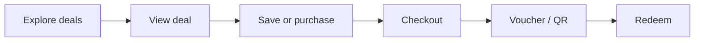
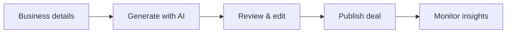
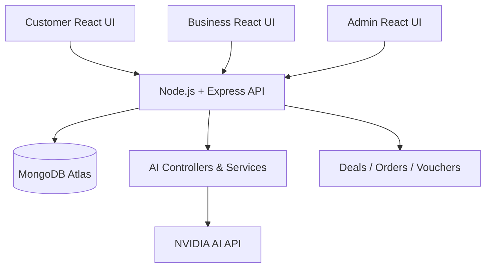

::: {align="center"}
# ⚡ HitMeUp

### Discover more. Spend less. Deal smarter.

**A real-time, AI-powered flash-deals marketplace connecting businesses
with customers.**


**[Overview](#-overview) · [Features](#-features) ·
[UI--design-system](#-ui--design-system) ·
[Architecture](#-architecture) · [Getting started](#-getting-started)**
:::

------------------------------------------------------------------------

## 🌟 Overview

**HitMeUp** is a MERN-stack marketplace for **limited-time flash
deals**. Customers discover offers, businesses create and manage
promotions, and platform administrators oversee marketplace activity.
AI-powered services help improve deal creation, discovery, targeting,
fraud checks, and insights.

> **Project status:** Active development. AI backend services have been
> developed and frontend integration is in progress. Screens and
> workflows below describe the intended product experience; not every
> feature is necessarily deployed.

### Who is it for?

  -----------------------------------------------------------------------
  👤 Customers            🏪 Businesses           🛡️ Administrators
  ----------------------- ----------------------- -----------------------
  Discover time-sensitive Publish and manage      Manage marketplace
  deals                   flash deals             activity

  Search and filter       Generate promotional    Review users,
  offers                  copy with AI            businesses, and deals

  Save, purchase, and     Track performance and   Monitor suspicious
  redeem offers           orders                  activity

  Receive relevant        Understand audiences    Review platform
  recommendations         and insights            analytics
  -----------------------------------------------------------------------

## ✨ Features

### Customer experience

-   🔎 Browse, search, and filter flash deals
-   ⏳ View limited-time offers and discount information
-   ❤️ Save favorite deals
-   🧠 Receive personalized deal recommendations
-   🛒 Purchase deals and access digital voucher/QR redemption workflows
    *(planned/integration-dependent)*

### Business experience

-   🏷️ Create, update, and manage promotions
-   ✍️ Generate deal titles, descriptions, discounts, and marketing copy
    with AI
-   🎯 Identify likely target audiences and marketing channels
-   📈 Explore AI-assisted business insights
-   📦 Manage deals and customer orders

### Admin experience

-   👥 Manage users and business accounts
-   🛡️ Review suspicious transactions or activities
-   📋 Moderate deals and platform content
-   📊 View platform-level reports

## 🤖 AI-powered services

  -----------------------------------------------------------------------
  Service                 Purpose                 Typical output
  ----------------------- ----------------------- -----------------------
  **Deal Generation**     Suggest a compelling    Title, description,
                          flash deal from         suggested discount,
                          business details        marketing message,
                                                  target customer

  **Deal                  Recommend relevant      Up to 3 suggested deals
  Recommendations**       deals to customers      with reasons

  **Fraud Detection**     Flag potentially        `isSuspicious`,
                          suspicious activity     `riskLevel`, `reason`

  **Food Safety**         Evaluate food-related   Classification and
                          descriptions for        explanation
                          potential concerns      

  **Smart Targeting**     Suggest likely          Target audience,
                          audiences and channels  interests, channels

  **Business Insights**   Summarize marketplace   Analytical summary and
                          or seller activity      observations

  **AI Activity Logs**    Record AI feature       Feature, input/output,
                          execution               status
  -----------------------------------------------------------------------

**AI provider:** NVIDIA AI API, accessed from the backend. AI results
should be reviewed before publishing or acting on them; classifications
are advisory rather than definitive.

```{=html}
<details>
```
```{=html}
<summary>
```
`<strong>`{=html}Example: AI deal generation request`</strong>`{=html}
```{=html}
</summary>
```
``` json
{
  "businessName": "HitMeUp",
  "businessType": "Cafe",
  "productOrService": "Chicken Burger",
  "originalPrice": 1019,
  "targetCustomers": "Students"
}
```

Possible response structure (illustrative, not a live API result):

``` json
{
  "title": "Student Burger Flash Deal",
  "description": "Limited-time offer on a chicken burger.",
  "suggestedDiscount": 20,
  "marketingMessage": "Grab your student deal while it lasts!",
  "targetCustomer": "Students"
}
```

```{=html}
</details>
```
## 🎨 UI & design system

The visual direction is **energetic, modern, and deal-focused**: bold
offer cards, clear prices, countdowns, easy-to-scan navigation, and
prominent calls to action.

### Brand palette

  -----------------------------------------------------------------------
  Token                   Hex                     Usage
  ----------------------- ----------------------- -----------------------
  🔴 **Primary**          `#FF4A2F`               Main buttons, active
                                                  states, offer
                                                  highlights

  🟥 **Dark**             `#C72814`               Strong emphasis and
                                                  darker brand accents

  🟢 **Success**          `#1FA061`               Success states,
                                                  redemption confirmation

  🟡 **Warning**          `#F5A719`               Countdown alerts and
                                                  caution states

  ⚫ **Ink**              `#141922`               Headings and primary
                                                  text

  ⚪ **Surface**          `#F9F9F9`               Page backgrounds and
                                                  subtle panels
  -----------------------------------------------------------------------

### Suggested UI components

  -----------------------------------------------------------------------
  Component                           Design direction
  ----------------------------------- -----------------------------------
  **Deal card**                       Product image, discount badge,
                                      merchant, current/original price,
                                      countdown, CTA

  **Primary button**                  Primary orange-red fill, white
                                      label, rounded corners

  **Search bar**                      Wide, accessible search field with
                                      category/filter actions

  **AI assistant panel**              Clear input form, generation state,
                                      editable result preview

  **Dashboard KPI card**              Concise metric, trend indicator,
                                      contextual label

  **Status badge**                    Semantic success/warning/danger
                                      colors and readable labels
  -----------------------------------------------------------------------

### Screen map

  -----------------------------------------------------------------------
  Customer app            Business dashboard      Admin panel
  (mobile-first)          (desktop-first)         (desktop-first)
  ----------------------- ----------------------- -----------------------
  Splash / Onboarding     Sign in                 Overview

  Sign in / Register      Dashboard               Users

  Home / Explore          Create Deal             Businesses

  Search / Filters        **AI Deal Generator**   Deal Moderation

  Deal Details / Store    Manage Deals            Orders & Payments

  Saved / Cart            Orders                  Fraud Monitoring

  Checkout / Payment      Analytics & Insights    Reports

  Orders / Vouchers       Reviews / Settings      Settings

  Notifications / Profile ---                     ---
  -----------------------------------------------------------------------

### Customer journey



### Business AI-assisted deal creation



> **Design note:** The screen map and diagrams are UI specifications,
> not screenshots of completed Figma screens. Add approved screenshots
> to `docs/screenshots/` as the interfaces are implemented.

```{=html}
<!-- Example once screenshots exist:


-->
```
## 🧱 Technology stack

  Layer            Technology
  ---------------- ---------------------------
  Frontend         React, Vite, Tailwind CSS
  Backend          Node.js, Express.js
  Database         MongoDB Atlas, Mongoose
  AI integration   NVIDIA AI API
  API style        REST
  Collaboration    Git, GitHub

## 🏗️ Architecture



### Repository layout

``` text
HitMeUp/
├── frontend/
│   ├── src/
│   │   ├── components/
│   │   ├── pages/
│   │   └── ...
│   └── package.json
├── backend/
│   ├── controllers/
│   ├── models/
│   ├── routes/
│   ├── services/
│   │   └── AI/
│   ├── package.json
│   └── .env                 # Local only; never commit
└── README.md
```

*Illustrative folder map based on the current project structure; exact
filenames may differ.*

## 🔌 AI API endpoints

These are the **expected route patterns** used during development;
verify actual mounted prefixes in the backend router before integrating.

  Method   Route                       Purpose
  -------- --------------------------- -----------------------------------
  `POST`   `/api/ai/generate-deal`     Generate promotional deal content
  `POST`   `/api/ai/recommend-deals`   Recommend deals
  `POST`   `/api/ai/detect-fraud`      Assess suspicious activity
  `POST`   `/api/ai/food-safety`       Check food-related descriptions
  `POST`   `/api/ai/targeting`         Suggest audience and channels
  `POST`   `/api/ai/insights`          Generate business insights

## 🚀 Getting started

### Prerequisites

-   Node.js and npm
-   A MongoDB Atlas connection string
-   An NVIDIA AI API key

### 1. Clone the project

``` bash
git clone https://github.com/miabdulrahman/HitMeUp.git
cd HitMeUp
```

### 2. Install backend dependencies

``` bash
cd backend
npm install
```

Create `backend/.env` using the variables your backend expects:

``` dotenv
PORT=5000
MONGODB_URI=your_mongodb_connection_string
JWT_SECRET=your_secure_jwt_secret
NVIDIA_API_KEY=your_nvidia_api_key
```

**Never commit `.env` or expose API keys in the React frontend.**

Start the backend using the script defined in `backend/package.json`
(commonly `npm run dev` or `npm start`).

### 3. Install frontend dependencies

In a second terminal:

``` bash
cd frontend
npm install
```

If the frontend reads a Vite API base URL, configure `frontend/.env`:

``` dotenv
VITE_API_URL=http://localhost:5000
```

Start the frontend:

``` bash
npm run dev
```

> Exact commands and environment variable names should be checked
> against the repository's `package.json` files and `.env.example`
> files.

## 🧪 Testing checklist

-   [ ] User registration and sign-in
-   [ ] Customer deal discovery and filters
-   [ ] Business deal creation and management
-   [ ] AI-generated deal preview and manual approval
-   [ ] Deal recommendation response
-   [ ] Fraud detection and AI activity logging
-   [ ] Checkout, payment, and voucher flows
-   [ ] Admin review and moderation
-   [ ] Mobile responsiveness and accessibility
-   [ ] Error handling, loading states, and security checks

## 🗺️ Roadmap

-   [x] Establish MERN application structure
-   [x] Develop core AI backend services
-   [ ] Integrate AI features into the React dashboards
-   [ ] Finalize customer, business, and admin UI
-   [ ] Complete end-to-end payment and voucher testing
-   [ ] Add automated tests and deployment configuration
-   [ ] Release a production-ready version

*Roadmap items represent development goals; completion status should be
updated by the project team.*

## 🤝 Contributing

HitMeUp is a collaborative team project. Create a feature branch, keep
commits focused, test your changes, and submit a pull request for
review.

## 🔐 Security notes

-   Keep API credentials and database connection strings server-side.
-   Validate requests and enforce role-based authorization.
-   Never rely on AI output alone for fraud or food-safety decisions.
-   Protect payment and voucher workflows against duplicate or
    unauthorized redemption.

------------------------------------------------------------------------

::: {align="center"}
### ⚡ HitMeUp --- Better deals, smarter connections.

**Built with the MERN stack and AI-powered services.**
:::
