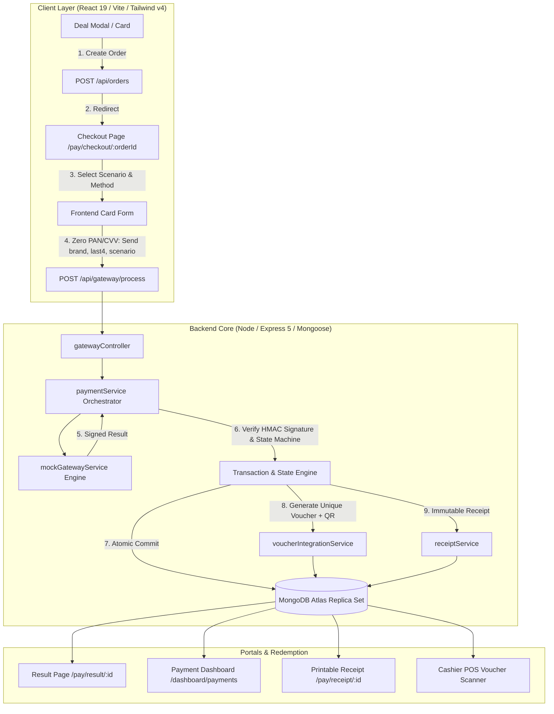
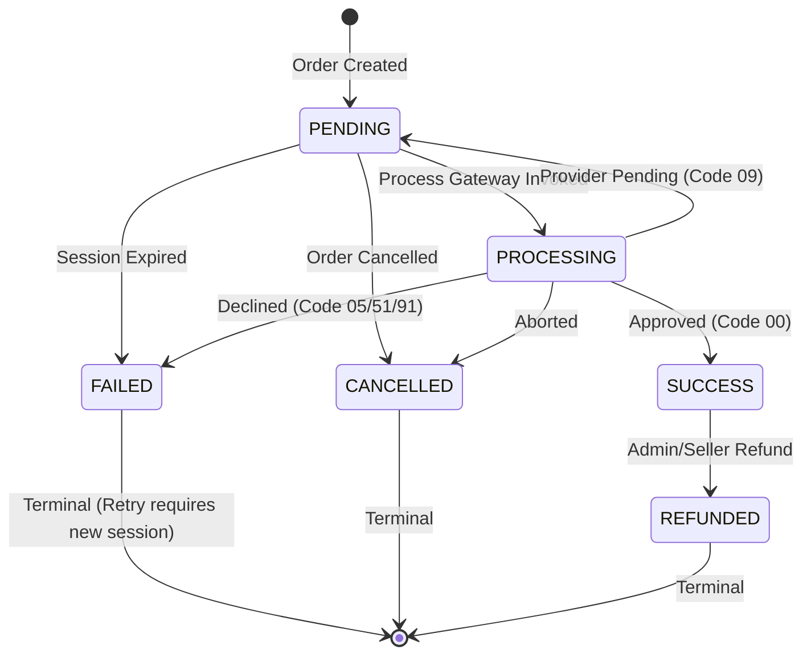

# HitMeUp Pay: Simulated Payment Gateway Architecture & Reference Guide

> **CRITICAL EDUCATIONAL DISCLAIMER**  
> **HitMeUp Pay is an educational, simulated payment processing platform.**  
> It processes **no real currency**, connects to no live banking or card networks, and accepts no genuine credit card numbers, CVVs, or bank credentials. All transactions, responses, and records are executed against an isolated simulation engine for academic and demonstration purposes.

---

## 1. Executive Summary & Product Identity

- **Platform Name**: HitMeUp Pay
- **Tagline**: *"Fast. Secure. Seamless."*
- **Description**: HitMeUp Pay is the integrated simulated payment processing platform for purchasing digital vouchers and flash deals within the HitMeUp marketplace. It allows customers to securely acquire deal vouchers, inspect cryptographic receipts, track real-time dashboard analytics, and simulate cashier POS voucher redemptions.

---

## 2. Architecture Overview

HitMeUp Pay adheres to a strict decoupled, provider-agnostic architecture. The marketplace business domains (`orders`, `deals`, `vouchers`) interface exclusively with `paymentService`, while `mockGatewayService` acts as an external simulated payment provider. Incoming transaction results are cryptographically signed using HMAC-SHA256, mimicking live providers such as Stripe or PayHere.



---

## 3. Design Decisions (Section 4 Compliance)

### 4.1 Free Claim vs Paid Purchase Coexistence
- **Free Deals / Direct Claims**: Free vouchers continue through `POST /api/vouchers/claim`.
- **Paid Purchases**: Flash deals proceed through `POST /api/orders` &rarr; `POST /api/gateway/process` &rarr; `Voucher`.
- **Unified Voucher Output**: Both paths create vouchers with the exact same schema structure (`orderId`, `customerId`, `dealId`, `code`, `qrData`, `status: "ACTIVE"`). Cashier scanning and the Customer Dashboard handle both types interchangeably.

### 4.2 Inventory Model: Atomic Reserve-Then-Commit
- **Order Creation**: Automatically decrements `Deal.availableQuantity` (`{ availableQuantity: { $gte: quantity }, status: "active" }`) upon order creation. An `expiresAt` TTL (15 minutes) is assigned.
- **Payment Success**: Commits reserved stock by atomically incrementing `Deal.claimedQuantity` (`{ $inc: { claimedQuantity: quantity } }`).
- **Payment Failure / Expiration / Cancel**: Safely releases stock back to `availableQuantity` exactly once via `inventoryReleased` guard flag.
- **Guarantees**: Stock never drops below 0 and cannot be double-counted or double-released.

### 4.3 Card Input & Zero Sensitive Data Transmission
- Full credit card Primary Account Numbers (PAN), CVVs, and expiry dates are **never transmitted to the server**, never written to storage, never logged, and never saved in MongoDB.
- The frontend card form maps test numbers locally to simulation scenarios and sends only:
  ```json
  {
    "orderId": "67cb1a2b3c4d5e6f7a8b9c0d",
    "paymentMethod": "CARD",
    "requestedScenario": "SUCCESS",
    "brand": "visa",
    "last4": "4242"
  }
  ```

### 4.4 Simulation Control
- Enabled via `PAYMENT_SIMULATION_ENABLED=true` in `backend/.env`.
- Scenarios validated against an allowlist: `SUCCESS`, `FAILED`, `PENDING`, `INSUFFICIENT_FUNDS`, `NETWORK_ERROR`, `CANCELLED`.
- Simulation determines mock provider decision codes; it **cannot** bypass database state machine rules, amount checks, ownership verification, or HMAC signatures.

### 4.5 Gateway-to-Backend Cryptographic Trust
- Every mock gateway response is cryptographically signed with HMAC-SHA256 using `GATEWAY_SIGNING_SECRET`.
- Signed payload parameters: `transactionId`, `orderId`, `amount`, `currency`, `responseCode`, `status`, `timestamp`.
- `paymentService` recalculates and verifies the signature prior to applying any mutations. Forged or replayed payloads are rejected with `403 Forbidden`.

### 4.6 Idempotency & Concurrency
- `POST /api/gateway/process` accepts an `Idempotency-Key` HTTP header.
- Backed by a unique sparse index on `GatewayTransaction.idempotencyKey` and `Payment.idempotencyKey`.
- Replay requests return cached transaction results without duplicate billing or secondary voucher issuance.

### 4.7 Money Handling & Currency
- Standard Currency: `LKR` (Sri Lankan Rupee).
- All payable amounts are server-calculated from trusted `Deal` records in MongoDB.
- Rounding: Enforced to 2 decimal places to eliminate floating-point drift.
- Optional platform processing fee is configured via `PAYMENT_FEE_PERCENT` (default: `0%`).

### 4.8 Role-Based Access Control (RBAC)
- **Customer**: View own orders, payments, receipts, and vouchers.
- **Seller**: View orders and transactions relating to deals owned by their verified `businessId`. Can refund payments on their own deals.
- **Admin**: Full visibility across all platform transactions, dashboard metrics, and authority to refund any transaction.

### 4.9 Refund & Voucher Invalidation Policy
- Refunding a `SUCCESS` payment updates status to `REFUNDED` and records an audit subdocument (`refundReference`, `refundedAt`, `refundedBy`, `reason`, `simulated: true`).
- The linked `Voucher` is transitioned to `REFUNDED` (invalidating it at POS).
- **Redeemed Vouchers**: If a voucher was already redeemed (`status === "REDEEMED"`), refund is strictly rejected with `422 Unprocessable Entity`.
- **Stock Restoration**: For unredeemed vouchers, stock is safely restored to `Deal.availableQuantity`.

---

## 4. Payment State Machine & Response Codes

Transitions are managed centrally in `services/paymentStateMachine.js`:



### Response Code Matrix
| Response Code | Status | Meaning |
|---|---|---|
| `00` | `SUCCESS` | Approved / Completed Successfully |
| `05` | `FAILED` | Transaction Declined |
| `51` | `FAILED` | Insufficient Funds |
| `91` | `FAILED` | Gateway Timeout / Network Error |
| `09` | `PENDING` | Pending External Settlement |
| `94` | `FAILED` | Duplicate Attempt |
| `54` | `FAILED` | Expired Session |

---

## 5. Demo Test Triggers

Use the following test credentials in the checkout form to trigger specific simulated outcomes:

| Card Number | Expiry / CVV | Simulated Scenario | Outcome Code |
|---|---|---|---|
| `4242 4242 4242 4242` | Any (e.g. 12/28, 123) | **SUCCESS** | `00 Approved` |
| `4000 0000 0000 0002` | Any | **FAILED** (Declined) | `05 Declined` |
| `4000 0000 0000 9995` | Any | **INSUFFICIENT_FUNDS** | `51 Low Balance` |
| `4000 0000 0000 0259` | Any | **PENDING** | `09 Pending Hold` |
| `4000 0000 0000 0119` | Any | **NETWORK_ERROR** | `91 Timeout` |

*For Bank Transfer and Mobile Wallet checkout methods, a demo outcome selector allows instant selection between `SUCCESS`, `PENDING`, and `FAILED`.*

---

## 6. API Reference

### 6.1 Orders
- `POST /api/orders`: Create order with atomic inventory reservation and 15-minute TTL.
  - Body: `{ "dealId": "...", "quantity": 1 }`
- `GET /api/orders/my-orders`: Retrieve customer's order history.
- `GET /api/orders/:id`: Single order details.
- `POST /api/orders/:id/cancel`: Cancel order and release reserved stock.

### 6.2 Gateway & Checkout
- `POST /api/gateway/checkout`: Initialize / retrieve active checkout session.
  - Body: `{ "orderId": "..." }`
- `POST /api/gateway/process`: Execute simulated payment.
  - Headers: `Idempotency-Key: <unique-key>`
  - Body: `{ "orderId": "...", "paymentMethod": "CARD", "requestedScenario": "SUCCESS", "brand": "visa", "last4": "4242" }`
- `GET /api/gateway/transactions`: Paginated, role-scoped transaction list.
- `GET /api/gateway/transactions/:id`: Single transaction audit record.
- `POST /api/gateway/transactions/:id/resolve`: Resolve a pending transaction in simulation.

### 6.3 Payments, Receipts & Refunds
- `GET /api/payments/dashboard/summary`: MongoDB aggregation analytics (total transactions, volume, approval rate, method distribution, daily timeline).
- `GET /api/payments/my-payments`: Customer payment history.
- `GET /api/payments/:id`: Payment record with linked order.
- `GET /api/payments/:id/receipt`: Immutable receipt document with verification reference.
- `POST /api/payments/:id/refund`: Execute simulated refund with voucher invalidation and stock restoration.
  - Body: `{ "reason": "Customer cancellation" }`

---

## 7. How to Swap in a Live Provider (e.g., Stripe / PayHere)

To transition from the simulated gateway to a genuine payment processor:
1. Create `services/stripeGatewayService.js` implementing the same signature contract:
   `processPayment({ orderId, amount, currency, metadata })`
2. Update `services/paymentService.js` to dispatch to the live provider when `process.env.PAYMENT_PROVIDER === "STRIPE"`.
3. In `routes/paymentRoutes.js`, route real webhooks (e.g. `POST /api/payments/webhook`) through `stripe.webhooks.constructEvent` before delegating to `paymentService.commitSuccessfulPayment`.
4. The marketplace order logic, voucher generation, QR codes, and cashier redemption flows remain **100% untouched**.
