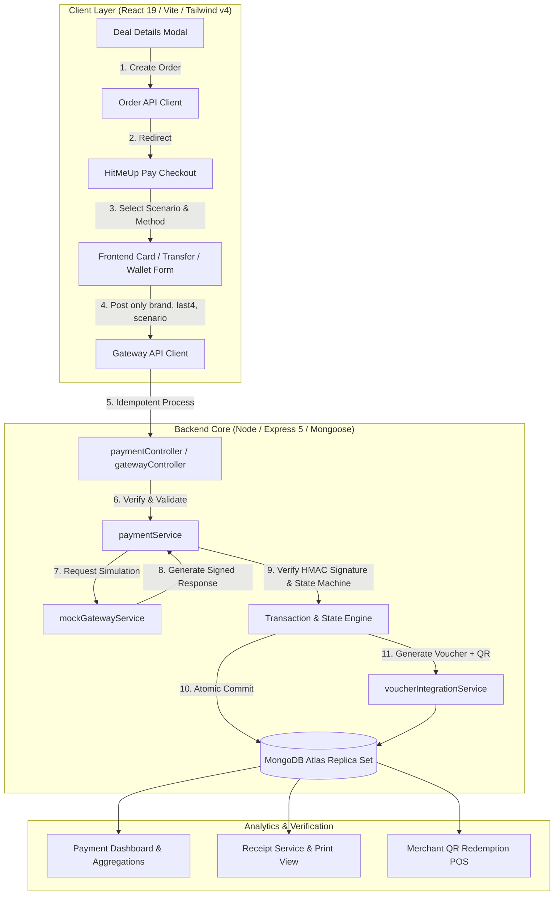
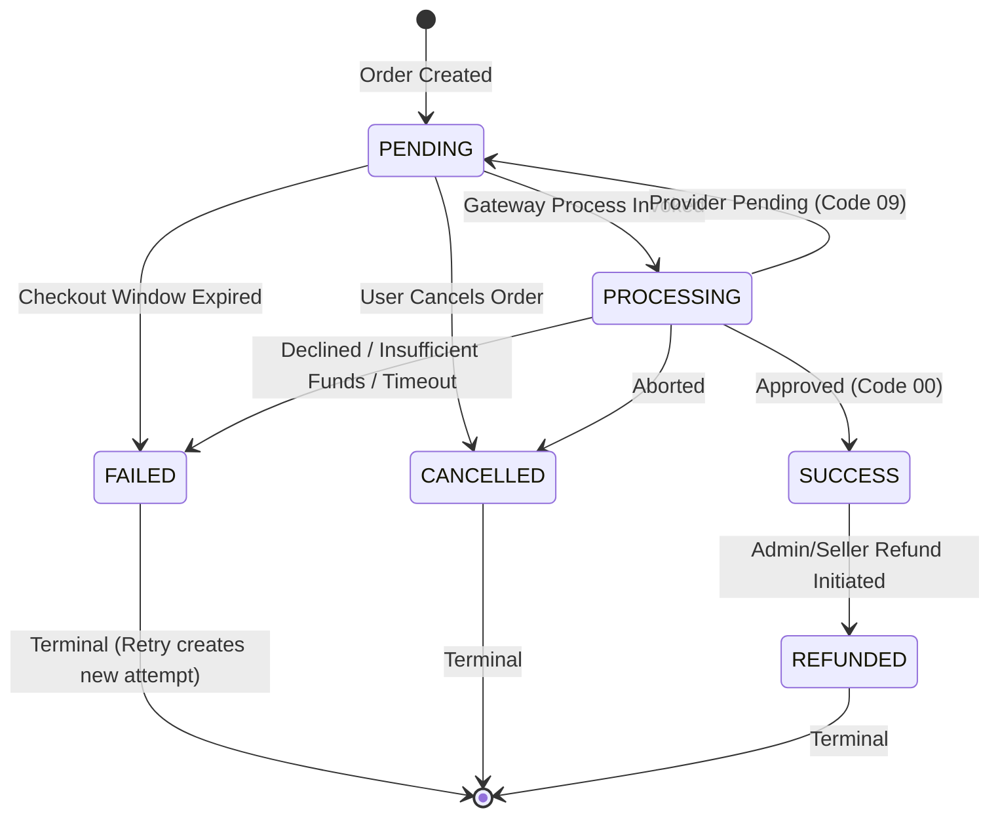

# HitMeUp Pay: Simulated Payment Gateway Documentation

> **CRITICAL NOTICE / EDUCATIONAL DISCLAIMER**  
> **HitMeUp Pay is an academic, simulated educational payment gateway.** It processes **no real money**, connects to no real banking networks, card brands, or wallets, and neither accepts nor stores genuine credit card numbers, CVVs, or bank credentials. All payment flows, responses, and records are executed against an isolated simulation engine for demonstration and educational purposes only.

---

## 1. System Architecture Overview

HitMeUp Pay is designed using an decoupled, provider-agnostic architecture. The marketplace business logic (orders, deals, vouchers, inventory) interacts exclusively with `paymentService`, while `mockGatewayService` acts as an external simulated processor communicating via signed payloads. This enables swapping the simulated gateway for a live provider (e.g., Stripe, PayHere) without altering marketplace domains.



---

## 2. Design Decisions & Audit Outcomes (Section 4)

### 4.1 Free Claim vs Paid Purchase Coexistence
- **Free Deals / Claims**: Deals with price 0 or free claims retain the existing `/api/vouchers/claim` route.
- **Paid Deals**: Customers proceed via Order creation (`POST /api/orders`) &rarr; Payment processing (`POST /api/gateway/process`) &rarr; Voucher generation.
- **Unified Voucher Output**: Both paths utilize the shared `voucherIntegrationService` to ensure vouchers have identical schema shapes (`orderId`, `customerId`, `dealId`, `code`, `qrData`, `status: 'ACTIVE'`), ensuring the Customer Dashboard and Merchant QR scanner work without differentiation.

### 4.2 Inventory Model: Reserve-Then-Commit
- **Model Selected**: Atomic **Reserve-then-Commit**.
- **Order Creation**: Conditionally decrements `Deal.availableQuantity` (`{ availableQuantity: { $gte: quantity }, status: "active" }`) upon creating a `PENDING` order, setting a 15-minute `expiresAt` window.
- **Payment Success**: Commits reserved stock by atomically incrementing `Deal.claimedQuantity` (`{ $inc: { claimedQuantity: quantity } }`).
- **Payment Failure / Cancellation / Expiration**: Safely releases stock back to `availableQuantity` exactly once via `inventoryReleased` flag guard.
- **Rationale**: Completely prevents overselling during high-traffic flash deal checkout sessions without risking negative inventory or phantom sales.

### 4.3 Card Input & PCI-DSS Compliance
- **Zero Sensitive Data Transmission**: The browser never transmits full Primary Account Numbers (PAN), CVVs, or expiration dates.
- **Client-Side Simulation Mapping**: The frontend maps test card numbers locally to simulation scenarios (`SUCCESS`, `FAILED`, `INSUFFICIENT_FUNDS`, `PENDING`, `NETWORK_ERROR`).
- **Payload Sanitization**: The frontend sends **only**:
  ```json
  {
    "orderId": "67cb1a...",
    "paymentMethod": "CARD",
    "requestedScenario": "SUCCESS",
    "brand": "visa",
    "last4": "4242"
  }
  ```
- Any unmapped number defaults to `SUCCESS` while only sending brand & last4. Form fields in state are immediately wiped after submission.

### 4.4 Simulation Control
- Controlled server-side via `PAYMENT_SIMULATION_ENABLED` (`true` in dev/demo).
- The backend strictly validates `requestedScenario` against an allow-list (`SUCCESS`, `FAILED`, `PENDING`, `INSUFFICIENT_FUNDS`, `NETWORK_ERROR`, `CANCELLED`).
- Simulation only influences the mock gateway's mock decision; it can **never** bypass amount checks, HMAC signatures, ownership checks, or database state-machine validation.

### 4.5 Gateway-to-Backend Trust (HMAC Verification)
- The mock processor signs every transaction response using `HMAC-SHA256` with `GATEWAY_SIGNING_SECRET`.
- Signed envelope fields: `transactionId`, `orderId`, `amount`, `currency`, `responseCode`, `status`, `timestamp`.
- `paymentService` recalculates and verifies the signature prior to applying any database mutations. Forged or replayed payloads are rejected with `403 Forbidden`.

### 4.6 Idempotency & Concurrency
- `POST /api/gateway/process` accepts an `Idempotency-Key` HTTP header (or body parameter).
- Supported by a unique sparse index on `Payment.idempotencyKey` and `GatewayTransaction.transactionId`.
- Concurrent or duplicate submissions with the same idempotency key immediately return the original transaction without duplicate charges or dual voucher generation.

### 4.7 Money Handling & Currency
- Currency standard: `LKR` (Sri Lankan Rupee).
- All amounts are computed server-side from `Deal.discountedPrice ?? Deal.originalPrice`. Client amounts are ignored.
- Values are formatted to 2 decimal places to avoid floating-point drift.
- Optional platform processing fee is configured via `PAYMENT_FEE_PERCENT` (default: `0%`). Formula:
  $$\text{subtotal} = \text{unitPrice} \times \text{quantity}$$
  $$\text{fee} = \text{round}(\text{subtotal} \times (\text{feePercent} / 100), 2)$$
  $$\text{totalAmount} = \text{subtotal} + \text{fee}$$

### 4.8 Role-Based Access Control (RBAC)
- **Customer**: Create orders, pay for own orders, inspect own orders/payments/receipts/vouchers.
- **Seller / Business**: Access only orders, payments, and metrics relating to deals owned by their verified `businessId`. Never accesses other merchants' metrics or customer details.
- **Admin**: Full visibility into all orders, payments, transaction records, and analytics across the marketplace; authority to execute simulated refunds on any transaction.
- **Refund Authority**: Admins can refund any eligible payment; Sellers can refund eligible payments belonging to their own deals.

### 4.9 Refund & Voucher Invalidation Policy
- Eligible for refund only if payment status is `SUCCESS`.
- `POST /api/payments/:id/refund` transitions payment to `REFUNDED` and records an audit subdocument (`refundReference`, `refundedAt`, `refundedBy`, `reason`, `simulated: true`).
- Associated voucher is moved to `REFUNDED` state (rendering it non-redeemable by cashiers).
- **Redeemed Vouchers**: If the voucher has already been redeemed (`status === "REDEEMED"`), the refund is rejected with `422 Unprocessable Entity`.
- **Stock Restoration**: For unredeemed vouchers, stock is safely restored to `Deal.availableQuantity`.

---

## 3. Payment State Machine

Transitions are enforced centrally in `paymentStateMachine.js`:



### Response Code Matrix
| Response Code | Outcome Status | Description |
|---|---|---|
| `00` | `SUCCESS` | Approved / Completed Successfully |
| `05` | `FAILED` | Transaction Declined |
| `51` | `FAILED` | Insufficient Funds |
| `91` | `FAILED` | Gateway Timeout / Network Error |
| `09` | `PENDING` | Pending Settlement / External Authorization |
| `94` | `FAILED` | Duplicate Transaction Attempt |
| `54` | `FAILED` | Order / Payment Session Expired |

---

## 4. Test Demo Credentials & Triggers

To test different scenarios in HitMeUp Pay, enter any of the test numbers below (or click the quick-select pills on the checkout page):

| Card Number | Expiry / CVV | Simulated Outcome | Response Code |
|---|---|---|---|
| `4242 4242 4242 4242` | Any (e.g. 12/28, 123) | **SUCCESS** | `00 Approved` |
| `4000 0000 0000 0002` | Any | **FAILED** | `05 Declined` |
| `4000 0000 0000 9995` | Any | **INSUFFICIENT_FUNDS** | `51 Insufficient Funds` |
| `4000 0000 0000 0259` | Any | **PENDING** | `09 Pending Settlement` |
| `4000 0000 0000 0119` | Any | **NETWORK_ERROR** | `91 Timeout` |

For Bank Transfer and Mobile Wallet checkout methods, a **Demo Outcome** toggle allows instant selection between `SUCCESS`, `PENDING`, and `FAILED`.

---

## 5. Environment Configuration

Add the following variables to `backend/.env` (and documented in `backend/.env.example`):

```bash
# HitMeUp Pay Configuration
PAYMENT_SIMULATION_ENABLED=true
GATEWAY_SIGNING_SECRET=hmp_dev_signing_secret_9876543210_token
PAYMENT_FEE_PERCENT=0
ORDER_TTL_MINUTES=15
SIMULATED_PROCESSING_DELAY_MS=1200
```
